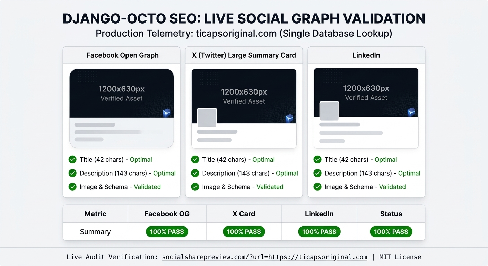

# SEO Audits & Social Preview Documentation

This directory contains historical technical audit records and social signal validation proofs for the **Ticapsoriginal** (`django_octo_seo`) project. These files serve as empirical evidence of large-scale indexing, domain architecture health, and social media metadata optimization.

---

## 📂 Included Files & Evidence

### 1. WebCEO Technical & Visibility Audit Report
* **File:** [webceo.pdf](./webceo.pdf)
* **Audit Platform:** [WebCEO](https://webceo.com)
* **Purpose:** Documents the structural health, crawlability, and search engine visibility metrics of the domain during peak indexing operations.
* **Key Metrics & Insights:**
  * **Crawl & Indexation Scale:** Validates the high volume of active URLs discovered and processed by search engine crawlers.
  * **Technical Health:** Demonstrates proper internal linking structure, status code integrity, and server responsiveness under massive page loads.
  * **Historical Baseline:** Serves as a permanent technical snapshot independent of the Google Search Console 16-month rolling data window.

### 2. Social Preview & Open Graph Validation ("Pass" Evidence)
* **File:** [live_social_validation.jpg](./live_social_validation.jpg)
* **Verification Tool:** [Social Share Preview](https://socialsharepreview.com)
* **Purpose:** Proves that the domain's Open Graph (OG) tags, Twitter/X Cards, and structured social metadata passed technical validation checks.
* **Key Metrics & Insights:**
  * **Social Share Readiness:** Confirms that shared links render rich previews (title, description, and featured image) cleanly across social platforms.
  * **Crawler Triggering:** Illustrates the social signal mechanism used to accelerate bot discovery and rapid URL indexing across the network.

---

## 🎯 Summary of Technical Impact

Together, these two audit artifacts demonstrate the synergy between **on-page technical readiness** (verified via [webceo.pdf](./webceo.pdf)) and **off-page social distribution triggers** (verified via [Social Share Preview](https://socialsharepreview.com)) to achieve rapid, large-scale search engine recognition.

---
